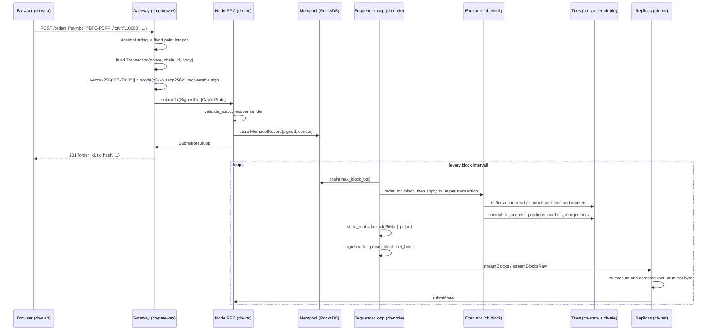

# Architecture

This document explains how SuperFrontierLiquid works: what happens between a
click in a browser and a state root on disk, why the matching engine is written
the way it is, how margin, funding and liquidation are computed, and which
storage engine holds what.

It describes the system as the code actually is at the time of writing, and says
so explicitly where a piece is designed but not yet built. `docs/PLAN.md` holds
the plan; this document holds the mechanism.

---

## 1. The shape of the system

```
        Browser (Rust -> WebAssembly, Leptos)
               |
               |  JSON over HTTP, WebSocket for streams
               |  every number is a decimal string (ADR 0006)
               v
        +--------------------+          SQLite
        |     cb-gateway     | <------>  users, sessions, faucet ledger,
        |   axum, custodial  |           candles, leaderboard, audit log
        +--------------------+
               |
               |  Cap'n Proto RPC over TCP (ADR 0001)
               v
        +--------------------+          RocksDB (22 column families)
        |      cb-node       | <------>  accounts, orders, books, positions,
        |     sequencer      |           margin, blocks, certificates, meta
        +--------------------+
             ^      ^
             |      |  streamBlocks / streamBlocksRaw, submitVote
             |      +----------------------+
             |                             |
        +---------+                  +-----------+
        | cb-sim  |                  |  cb-node  |  x2
        |  load   |                  |  replica  |
        +---------+                  +-----------+
```

One process produces blocks. Replicas follow it and vote. There is no leader
election at runtime: the proposer address is fixed at genesis, and the view
number never advances. See §6.

The gateway is a separate process from the node for a reason worth stating: it
holds application state and player keys, and it must never be able to write
consensus state except by submitting a signed transaction like anybody else.

---

## 2. From a click to a state root

The path below is the full one. The first two steps are the part still under
construction — `cb-gateway` is being written now, and `cb-web` is currently a
build-chain spike. Everything from `submitTx` onward runs today, and can be
driven from `cb-client`.



### 2.1 Signing

A transaction is `Transaction { nonce: u64, chain_id: u32, body: TxBody }`. There
are eighteen `TxBody` variants, covering transfers, deposits and withdrawals,
spot order placement and cancellation, perpetual order placement and
cancellation, position open/close, margin adjustment, liquidation triggers,
oracle updates, funding ticks and futures settlement.

The signing hash is `keccak256("CB-TX\0" || bincode(transaction))`. The
signature is a recoverable secp256k1 ECDSA signature with a low-S rule, and the
sender's address is the last 20 bytes of `keccak256` of the uncompressed public
key — Ethereum's scheme. Block headers are signed over
`"CB-BLOCK\0" || bincode(header)` and votes over their own tag, so no two
message types share a hash space.

Replay scoping is structural: `chain_id` and `nonce` are fields inside the
signed struct, and `chain_id` is compared against `Meta::chain_id()` at RPC
admission and again in the executor.

### 2.2 Submission and the mempool

`submitTx` runs `validate_static` — non-zero amounts, quantities and prices,
slippage within 10,000 bps, a well-formed `DerivId`, an oracle price below 1e36
— then recovers the sender once and stores a `MempoolRecord` carrying both the
signed transaction and the recovered address. Recovery is the expensive part of
the pipeline, and it is deliberately not repeated later.

`validate_static` is called from exactly two places: the RPC submit path and the
in-process benchmark generator. A transaction injected by any other route
bypasses it.

### 2.3 Block building

The sequencer loop drains up to `--max-block-txs` records, decodes them in
parallel, and deletes them from the mempool. **If nothing is pending, no block is
produced.** An idle chain sits at its current height indefinitely; that is
normal, and it surprises every new operator once.

The sequencer then adds the system transactions this height requires —
funding ticks at an interval boundary, settlements for expired futures —
signed with its own key (`required_system_txs`), and ordering is made
deterministic: each account's transactions are grouped in nonce order, groups
are ranked cancellations first, then post-only placements, then everything
else, and within a rank accounts are permuted by `keccak(parent_hash ‖ sender)`
so no address holds a standing priority. The sort is the only thing that
decides execution order; arrival time does not enter into it, and a replica
applies the committed order rather than re-sorting.

Two block-level checks run before the transaction loop: the block must contain
the funding ticks due at this height, and the futures settlements due at this
height. Both produce a named error if a required system transaction is missing,
and both sort their required set by market id so every node reports the same
first missing market.

### 2.4 Execution

Each transaction goes through `apply_tx_at(state, ctx, verified_tx, tx_index)`.
The first check is the nonce: it must equal the sender's current nonce exactly.
Then the handler for the body runs — matching, margin checks, balance movement,
book mutation.

Order identifiers and book sequence numbers are derived, not generated:

```rust
derive_order_id(sender, block_height, tx_index, intra_tx_counter)
pack_seq(block_height, tx_index, intra_tx_counter)
```

No clock, no counter in memory, no random number generator. Replay the same
transactions in the same order and you get the same order ids.

A failing transaction is rolled back to a savepoint and dropped from the block;
the rest of the block goes on. Because the loop deleted the mempool rows before
building, a dropped transaction is not retried — the node logs it and forgets
the sender's admission nonce so the next submission is measured against the
chain.

### 2.5 The state root

Account writes are buffered in a `BlockState` and flushed in one RocksDB write
batch at commit. Positions and markets are tracked as "touched" sets and their
tries recomputed for those keys. The commit produces four roots, and the state
root is their keccak hash:

```
state_root = keccak256( accounts_root || positions_root || markets_root || margin_root )
                        (32 bytes)      (32 bytes)        (32 bytes)      (32 bytes)
```

Each of the four is the root of a binary radix merkle trie (`cb-trie`) keyed by
`keccak256(key)` and traversed one bit per level. Leaves and branches are
encoded explicitly and hashed with keccak256:

```
leaf   = 0x00 || suffix_len(u8) || key_suffix || value_len(u32 BE) || value
branch = 0x01 || left_hash(32) || right_hash(32)
empty  = 0x00 * 32
```

The four key spaces are: accounts by 20-byte address; positions by
`owner || deriv_id` (24 bytes); markets by `deriv_id` (4 bytes), with perpetuals
and dated futures sharing one trie and a leading byte tagging which kind a value
is; and margin accounts by 20-byte address.

**The margin slot was added late, and it is a hard fork of the root.** For most
of the chain's life the preimage was the first three roots only, and margin
accounts — every trader's collateral, every unpaid loss, and the insurance fund,
which is just the row at `Address::INSURANCE` — were in no trie at all. Two
replicas could therefore disagree about who was solvent while reporting
byte-identical state roots, and genesis-seeded collateral was unauthenticated
for the same reason. The fourth slot is appended at the tail, so the existing
three keep their indices, but every previously pinned root literal moves; the
experimental chain is re-genesis'd rather than migrated.

**What the state root still does not cover.** Funding indices, oracle and mark
prices, the liquidation queue, the perpetual order book, the mark-price history
ring buffer, and spot orders. Those live in their own column families and are
read directly. Everything in that list is derivable from the committed data plus
the block stream, which is the argument for leaving it out; it is still the first
place to look when replicas behave differently but roots match. Margin accounts
were never derivable in that sense, which is why they are no longer on the
list.

The block header is then assembled and signed:

```rust
BlockHeader { height, prev_hash, tx_root, state_root, timestamp,
              view, parent_qc, sequencer_sig }
```

`tx_root` is not a merkle root despite the name — it is
`keccak256(concat(bincode(tx)))` over the block's transactions. There are no
transaction inclusion proofs.

### 2.6 Replica sync

A replica connects to the sequencer and streams from its own head height plus
one. There are two modes and the difference is important.

**strict-sync** (`--strict-sync`) pulls decoded blocks via `streamBlocks` and
calls `apply_remote_block`, which checks, in order: the height is exactly head
plus one; the proposer signature recovers to the address recorded at genesis;
`prev_hash` is the hash of the local head; the timestamp is not below the head's;
`tx_root` is the hash of the body;
every transaction's signature is recovered in parallel and, when the leader
shipped its own `senders`, agrees with them (the leader's list is a prefetch
hint, never a substitute for recovery); the required funding ticks and
settlements are present; every transaction applies; and finally that
re-executing produced the same `state_root` the header claims. Any failure
returns an error and nothing is persisted.

**fast-mirror** (the default) pulls pre-encoded bytes via `streamBlocksRaw` and
writes them, with a head pointer, straight into a mirror column family. It does
not decode, does not execute, and does not recompute the state root. Its vote
attests that a block was received, not that it was valid.

That default is worth restating plainly: **out of the box, a replica is a block
log backup, not an independent verifier.** The determinism guarantee is only
exercised when replicas run with `--strict-sync`.

Two asymmetries between builder and replica exist today: the replica enforces
required funding ticks but not required futures settlements, and a parent
quorum-certificate verification failure is logged as a warning rather than
rejecting the block.

---

## 3. Why the engine is pure, and why that is what makes replicas agree

`cb-engine` contains the matching, margin, funding, liquidation, mark-price and
settlement mathematics. Its entire dependency list is `cb-types` and
`thiserror`. There is no `std::fs`, no `std::io`, no `tokio`, no `SystemTime`,
no `Instant`, no random number generator anywhere in the crate. Every entry
point is a function of its arguments.

The matcher does not even read the book: it takes a `BookSnapshot` — a
read-only trait with three methods — and returns a `MatchResult` describing what
should happen. Applying that result to storage is somebody else's job, in
`cb-block`. Where the engine does use a `HashMap` internally, it sorts before
emitting, with a comment saying why: `HashMap` iteration order is not
deterministic.

Purity here is not an aesthetic preference. It is the mechanism by which two
machines agree.

The state root is a hash of storage. Storage is written by the executor. The
executor's decisions come from the engine. If any engine function consulted a
clock, a random seed, an environment variable or a hash-map iteration order,
then two nodes replaying the same blocks would write different bytes and
produce different roots — and the failure would not be a crash, it would be a
silent fork discovered later.

So determinism is enforced at every layer where nondeterminism could enter:

| Source of nondeterminism | How it is removed |
|---|---|
| Transaction arrival order | `order_for_block`: group by sender in nonce order, groups ranked cancel > post-only > rest, then by `keccak(parent_hash ‖ sender)` |
| Identifier generation | `derive_order_id` from (height, tx_index, counter) |
| Wall-clock time | Timestamp is a header field, set once by the proposer |
| Map iteration order | Sorted before use; trie iteration is byte-ordered |
| Floating point | There is none: `u128` and `i128` at fixed scales |
| Storage iteration | `KvStore::scan_prefix` must be ascending byte order |

And the check that it worked is `apply_remote_block`: re-execute, recompute,
compare. `cb-block/tests/determinism.rs` and `cb-block/tests/state_root_completeness.rs`
pin it in CI.

---

## 4. Margin, funding, liquidation, settlement

### 4.1 Scales

Three fixed-point scales appear in the derivatives code, and confusing them is
the most likely arithmetic bug in the system.

| Quantity | Scale | Type | Example field |
|---|---|---|---|
| Price | 1e8 (`q8`) | `u128` | `Position.entry_px_q8`, `OraclePrice.px_q8` |
| Rate | 1e9 (`q9`) | `i64` | `FundingIndex.rate_q9` — 5_000_000 is 0.5% |
| Notional, collateral | 1e6 (micro-USD) | `u128` | `MarginAccount.collateral` |
| Derivative quantity | 1e8 contract units | `u128` | always, for every underlying |
| Spot quantity | the asset's own decimals | `u128` | BTC 8, ETH 18, USD 6, equities 6 |

The last two rows coincide for BTC and for nothing else: one AAPL share is
1,000,000 spot units and 100,000,000 contract units.

### 4.2 Margin

Notional is derived from quantity and mark price:

```rust
position_notional_micro_usd(qty, mark_q8) = qty * mark_q8 / 1e10
```

The 1e10 absorbs the q8 price scale plus the two decimal places between an
8-decimal underlying and 6-decimal USD. It is hard-coded, and the source says
so: an 18-decimal underlying would need a different denominator. Listing an
ETH-denominated perpetual today would compute wrong notionals.

Equity is collateral **less bad debt** plus unrealised PnL across open
positions, where PnL is signed by side: a long gains when mark exceeds entry, a
short gains when entry exceeds mark. Bad debt is what the account owes the
protocol after a loss its collateral could not cover, and subtracting it is what
makes an indebted account one with negative money rather than one with none —
without that, a wiped-out account could be funded again and pass the gate as
though it owed nothing. Initial and maintenance requirements are the sum over
positions of notional times the market's margin rate in basis points, taken from
a leverage tier table. An order is admitted if the account would still pass its
initial margin requirement after the fill — the executor simulates the worst-case
resulting position set rather than assuming the fill happens at the limit.

A reduce-only order skips that gate, and that is only sound because it can
genuinely only reduce. Two layers enforce it: admission rejects an order larger
than the position it claims to close, and the matcher caps the fill plan against
live position state, because a reduce-only order that was valid when it was
placed can be hit as a maker after the position it was written to close is gone.
A resting reduce-only order with nothing left to reduce is deleted from the book
rather than filled.

### 4.3 Funding

Funding transfers value between longs and shorts so that a perpetual tracks its
index. The rate combines a premium index — how far the book's midpoint has
drifted from the oracle, as an exponentially weighted average folded in one
eighth per oracle update — with an interest-rate term, and is clamped to the
market's configured cap. The same midpoint enters the mark price, so the
"median of three" is a median of oracle, book and last trade rather than of
oracle, oracle and last trade.

Accrual is per block, not per wall-clock hour: a cumulative index advances by
`rate * elapsed_blocks`, and a position's funding is the difference between the
index now and the stamp the position carries. That stamp is the market's live
cumulative index at the moment the position opened — volume-weighted with the
existing stamp when a position grows, exactly as the entry price is — which is
what keeps the flows cancelling. A position stamped with zero would be charged
for the market's whole history before it existed, with nobody on the other side
of the transfer.

Funding is applied by an explicit `FundingTick` transaction, one per market.
Only the block proposer may send it, and the block builder refuses to build a
block that is missing a tick that is due. That is what makes funding part of
consensus rather than a background job.

### 4.4 Liquidation

An account below maintenance margin is liquidatable. A `LiquidationTrigger`
transaction names an owner and a market; the executor re-checks the condition
itself rather than trusting the sender, computes the orders that close the
position, and charges a fee.

Before any of that it cancels the owner's resting orders on the market. An
account being liquidated must not still be quoting the market it is being
liquidated on: the tranches go through the ordinary matcher with self-trade
prevention on, so a single resting order on the closing side used to reject every
tranche and let the account block its own liquidation entirely. Cancelling is
also what stops the victim filling against their own quote at a price they chose.

The fee is 50 basis points of notional, split 30 to the insurance fund and 20 to
the keeper who sent the trigger. If closing the position leaves the account
short, the shortfall is bad debt and the insurance fund absorbs it — and so it
does wherever else bad debt arises, which is an ordinary fill, a funding tick or
futures settlement. Absorption happens at the moment the debt is recorded rather
than in an end-of-block sweep, because there are three independent block drivers
and a hook installed in one of them is a fourth way for two nodes to disagree.
If the fund is exhausted the residual stays outstanding and the market halts to
reduce-only. The insurance fund's collateral is visible on the operator
dashboard, including a sparkline, because it is the number that tells you whether
a cascade is being contained.

### 4.5 Dated futures

A dated future has an expiry height. At that height it stops trading and
settles, by one of two methods chosen at listing: a time-weighted average of
mark prices over the final window, or the oracle price at expiry. Settlement
closes every position at the settlement price and, as with funding, is driven by
a required system transaction the builder will not omit.

As expiry approaches, the clamp that keeps the mark price near the index tightens
— a dated contract must converge on its settlement basis, not drift with its own
order book.

### 4.6 Fees, and one remaining gap

Perpetual markets carry `taker_fee_bps` and `maker_fee_bps_signed`, and both are
now charged. The taker fee is a transfer into the insurance fund's margin
account — the same sink the spot side uses, so nothing is minted or burned. A
negative `maker_fee_bps_signed` is a rebate paid out of that fund and capped by
what it holds, and it carries a wash-trade guard: the quote must have survived a
block boundary, which is what `PerpOrder.placed_at_height` is for. Liquidation
tranches are exempt, because the liquidation fee is already charged against the
same account. Spot fees are charged from the market's `fee_bps` and credited to
the same address.

**The gap that remains.** A resting perpetual order reserves no collateral. The
initial-margin gate simulates a worst-case fill of the single order being placed
against the account's current positions, so N resting orders can each pass the
gate independently and then all fill, leaving the account past the leverage any
one of them implied. Closing it means either reserving margin per resting order
or widening the gate to the account's whole resting book; both need a per-owner
index over `CF_PERP_ORDERS`, which is keyed by order id alone today, because
otherwise every order placement pays a full scan of the order column family.

---

## 5. Two storage engines, two jobs

ADR 0002 records the decision; this is the mechanism.

**RocksDB, inside the node.** Twenty-one column families in one data directory.
The families divide into consensus state (`accounts`, `positions`,
`perp_markets`, `futures_markets`), derived indexes (`book_index`,
`perp_book_index`, `block_by_hash`), the chain itself (`blocks`,
`mirror_blocks`, `qc`, `meta`, `validators`), the mempool, and the trie node
store. Each family is tuned separately: LZ4 on small hot values, ZSTD on large
ones, bloom filters where lookups are by exact key.

The property that matters is ordered iteration. The book index key is
`deriv_id || side || price (16 bytes BE) || seq (8 bytes BE)`, so iterating a
prefix yields price-time priority directly out of the storage engine. The trie
depends on the same ordering for its structure, and therefore so does the state
root. `cb_ports::KvStore` states this as a contract: an implementation that
iterates in any other order will fork the chain.

RocksDB takes an exclusive lock on its directory. One node per data directory,
always.

**SQLite, inside the gateway.** Users, sessions, faucet claims, candle
aggregates, leaderboard snapshots, audit records. This data is queried by time
range and by foreign key, it changes shape as the product changes, and it needs
migrations — three things RocksDB is bad at and SQLite is good at. None of it is
consensus state, and losing it would not fork anything.

The split is enforced by the ports layer rather than by convention.
`cb_ports::db` documents what may not cross: balances, orders and positions are
read from the node's RPC, never from a repository, because a repository copy
would be a second source of truth and the two would drift.

Neither engine is named above its port. `cb-gateway` depends on `AppDatabase`,
not on SQLite; the trie depends on `KvStore`, not on RocksDB. Wiring happens
once, in a binary's composition root.

---

## 6. Consensus

Two schemes, chosen at genesis by `init --consensus` and recorded in
`Meta::consensus_scheme`.

**Sequencer** (`make start`): one node builds and signs every block, replicas
re-execute and attest. The votes and certificates in `cb-consensus`'s root
module are that attestation; with n=3 it tolerates one crash and no Byzantine
validator, and a follower with `--failover-after-ms` takes over when the leader
stops. This is the original design and it is unchanged.

**BFT** (`make startbft`, ADR 0008): `cb_consensus::bft` is a chained HotStuff
with a two-chain commit rule and a timeout-certificate pacemaker. Rounds have a
rotating leader; a proposal extends the highest certificate its leader knows; a
round ends with a quorum certificate or a timeout certificate; two consecutive
certificates commit. `n = 3f + 1`, quorum `ceil(2n/3)`: four validators
tolerate one Byzantine one. Votes are broadcast so every validator forms every
certificate itself.

Consensus orders; execution follows. A proposal is a transaction list and the
certificates that justify it, with no state root of its own. Committed
proposals go to an executor thread, in order, through the same pipelined
`execute_and_hand_off` the sequencer uses, with the ordering seed and the
proposer taken from the proposal. A transaction that fails stays in the block
and is skipped identically everywhere; the required funding ticks and
settlements are injected as unsigned synthetic transactions. The executed block
carries the proposal and its certificate in the header's `parent_qc` slot as a
finality proof, and an observer verifies that proof instead of a header
signature (`apply_remote_block` branches on the scheme).

A proposer also states its latest executed height and root, and a validator
whose own root there differs refuses to vote: execution is audited by the
validators a couple of blocks after the fact.

Transactions reach the other validators as batches over the consensus channel,
not by gossip, and a validator proposes a sender's transactions only as an
unbroken nonce run continuing from the chain and the proposals in flight.

The engine is a pure state machine with a deterministic simulator
(`cb-consensus/src/bft/sim.rs`) that runs crashes, a restart, an equivocating
leader, a partition and lossy links and checks byte-for-byte agreement.
`cb-node/tests/bft_execution.rs` drives four validators through real
transactions and has an observer replay their blocks through the proof.

---

## 7. The ports seam

`cb-ports` defines a trait for every dependency a production deployment would
want to replace, and two rules keep the seam honest: no crate above it may name
a concrete backend, and nothing in it may depend on one.

| Trait | Default here | Production substitute |
|---|---|---|
| `AppDatabase` (+ repositories) | SQLite | PostgreSQL, MySQL |
| `EventBus` | in-process broadcast | Kafka, NATS |
| `KvStore` | RocksDB | any ordered KV store |
| `MarketDataFeed` | seeded random walk | exchange feeds, vendor APIs |
| `EquityReferenceData` | static fixture | reference-data vendor |
| `CustodyProvider` | simulated deposits | a qualified custodian |
| `IdentityProvider` | handle plus recovery code | OIDC, SSO |
| `Clock` | injectable | system clock |

Two details are easy to miss and load-bearing. `PortError` is a closed enum
rather than `anyhow::Error`, because callers branch on it to decide whether to
retry, and that decision must not depend on which backend is plugged in — a
SQLite unique violation and a PostgreSQL unique violation both arrive as
`PortError::Conflict`. And `Clock` is a port because funding accrual, faucet
cooldowns, session expiry and candle bucketing all turn on "what time is it": a
test that cannot move time has to either sleep or skip the branch.

---

## 8. What is not built yet

Being specific here is more useful than being encouraging.

The L1 core — types, crypto, schemas, trie, state, transactions, engine, block
building, consensus messages, genesis, RPC, replica sync, node, client,
dashboard and the load simulator — is ported and working. That is what §2
through §6 describe, and it can be driven end to end today from `cb-client`.

The exchange layer is under active construction. `cb-gateway`, `cb-store-sqlite`,
`cb-bus`, `cb-feed` and `cb-simgame` are being written now; `cb-web` is a
build-chain spike that mounts one paragraph. The REST and WebSocket API in
`docs/api-contract.md` is a specification, not a description: nothing serves it
yet. Treat every endpoint in that document as a promise until you have seen it
respond.

The README's status table is the honest, dated summary. This document describes
mechanism; the README describes what you can run.
